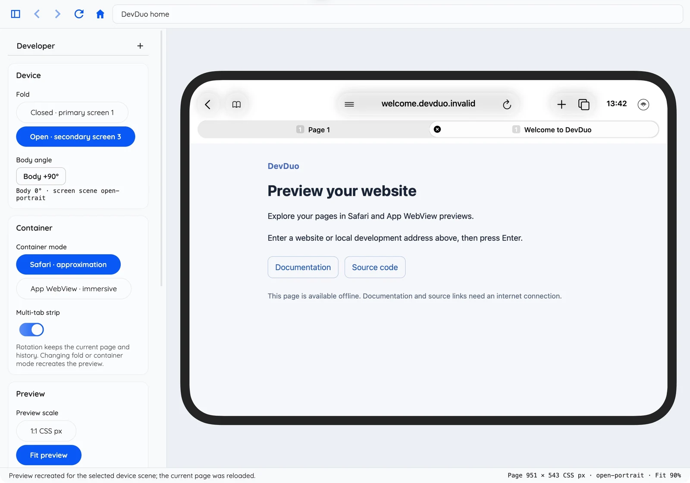
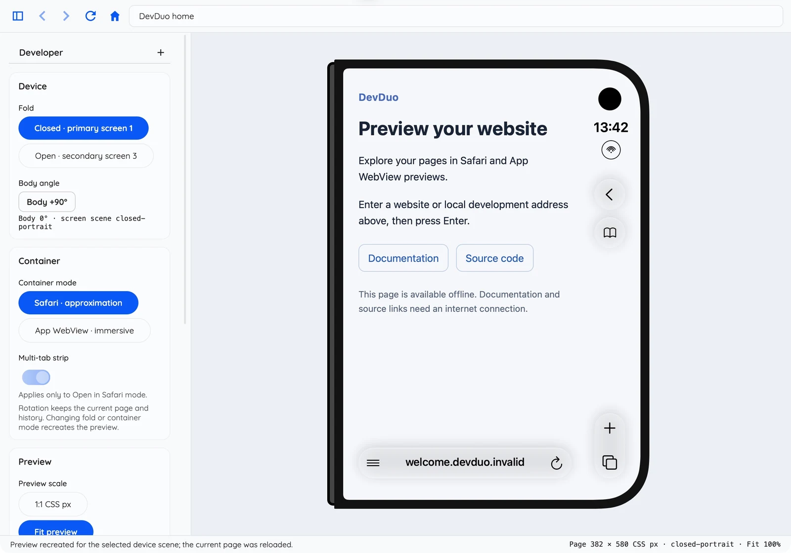

# DevDuo

**Pseudo iPhone Duo Viewport Simulator for Web Developers**

[English](README.md) · [简体中文](docs/zh/README.md) · [Documentation](https://dev-duo.aitiotekt.com/)

Preview your website in measured iPhone Duo simulator viewports on your desktop. Switch between folded and unfolded layouts, rotate the device, and compare a floating Safari shell with an immersive App WebView.

**[Download](#download-and-install)** · **[Quick start](#your-first-preview)** · [Usage guide](docs/en/004-USAGE.md)

*Actual macOS app, displaying the bundled offline welcome page. [Screenshot provenance](docs/shared/app-preview/provenance.json).*

## Why DevDuo?

- **Check both containers.** Preview page-colored, translucent Safari controls, or remove the shell for an immersive app layout.
- **Explore responsive layouts.** Compare both folds and four body angles; Fit preview keeps the logical CSS viewport intact.
- **Inspect as you work.** Open a local development URL, use Web Inspector, and switch between English and 简体中文.

DevDuo is an experimental layout aid using desktop WebKit, not an iOS runtime. Safari materials are approximations; physical hardware dimensions and radii are unknown. It is an independent project, unaffiliated with Apple. See the [measured scene reference](docs/en/005-SAFARI-SCENES.md) for scope and evidence.

## Download and install

Open **[application releases](https://github.com/aitiotekt/DevDuo/releases)** and choose a `v…` release, including the beta prerelease. The separate `webkit-v…` releases contain an engine dependency, not the DevDuo app.

| Your computer | Download | Install |
| --- | --- | --- |
| Apple silicon · macOS 27 or later | `DevDuo-v<version>-osx-arm64.zip` | Extract in Finder, move **DevDuo.app** to Applications, then open it. |
| Windows · x64 | `DevDuo-v<version>-win-x64.zip` | Extract the entire ZIP to a writable folder, then run **DevDuo.exe** inside it. Keep the bundled `webkit/` directory beside the executable. |

The application packages include .NET, offline debugging assets and, on Windows, the matching WebKit runtime. No Xcode, mise, Node or Python setup is needed to use them. Intel Macs, Windows ARM and Linux have no application release package.

For signing information or a blocked download, consult [release signatures and installation help](docs/en/013-RELEASE.md#download-trust-and-installation-help). To build from source, use [Contributing](CONTRIBUTING.md).

## Your first preview

1. Launch DevDuo. The offline welcome page appears on first use; **Home** returns to it at any time.
2. Enter your website or local development URL in the top address bar, for example `http://localhost:5173`, then press **Enter**. Your development server runs separately on the same computer.
3. In the settings sidebar, choose **Closed** or **Open**, then **Body +90°** to compare orientations.
4. Choose **Safari · approximation** or **App WebView · immersive**. In Open Safari, **Multi-tab strip** previews two illustrative tabs; it does not open a second page.
5. Select **Fit preview** to see the whole device, or **1:1 CSS px** for an unscaled preview. Drag to swipe down and back up to compare the compact and expanded Safari shell. Choose **Mouse** under **Interaction** for wheel scrolling.

Use **⌘L / Ctrl+L** to focus the address bar and **⌘R / Ctrl+R** to reload. Language and light/dark theme live under **Appearance**. More controls, shortcuts and inspection options are in the [usage guide](docs/en/004-USAGE.md).

## Help and project information

| Looking for… | Start here |
| --- | --- |
| Controls, debugging and settings | [Usage guide](docs/en/004-USAGE.md) |
| Changes and planned improvements | [Changelog](CHANGELOG.md) · [UI roadmap](docs/en/100-ROADMAP.md) |
| A bug report or feature request | [GitHub Issues](https://github.com/aitiotekt/DevDuo/issues) — include your app version, OS and steps to reproduce. |
| Development and AI-assisted contributions | [Contributing](CONTRIBUTING.md) — setup and checks; [AGENTS.md](AGENTS.md) — coding-agent rules. |
| Vulnerability reporting and local data | [Security](SECURITY.md) · [Privacy](PRIVACY.md) |
| Signing, certificates and release maintenance | [Releases and administration](docs/en/013-RELEASE.md) |
| License and bundled components | [MIT license](LICENSE) for first-party code; [third-party notices](THIRD_PARTY_NOTICES.md) cover dependencies and simulator-artwork redistribution uncertainty. |

[English](README.md) | [中文](docs/zh/README.md)
