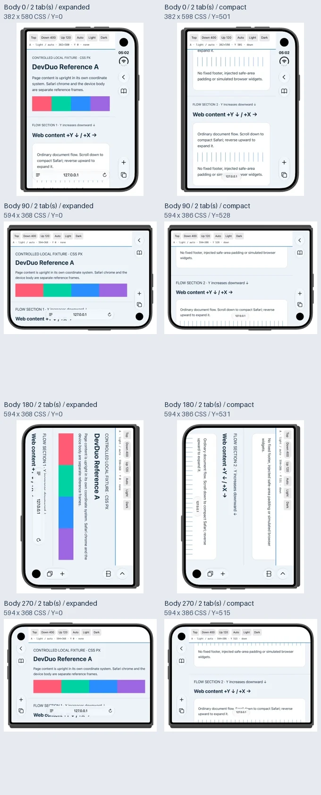
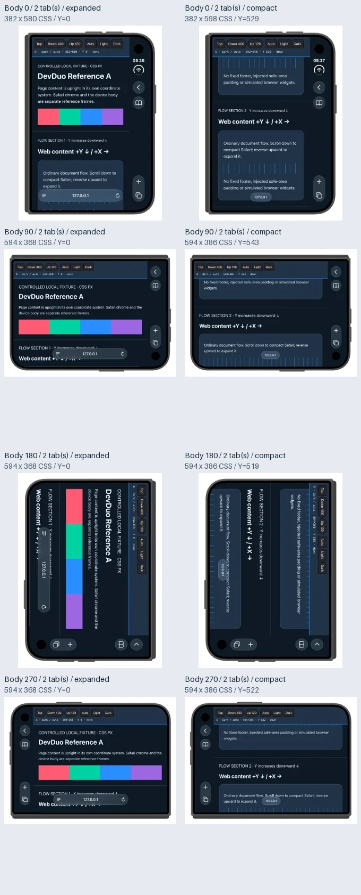
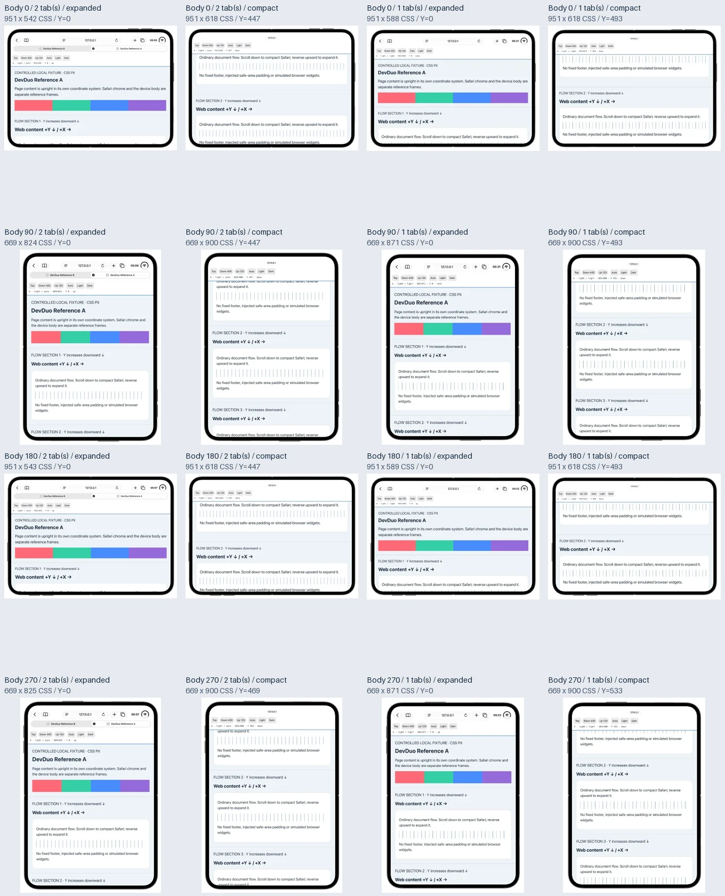
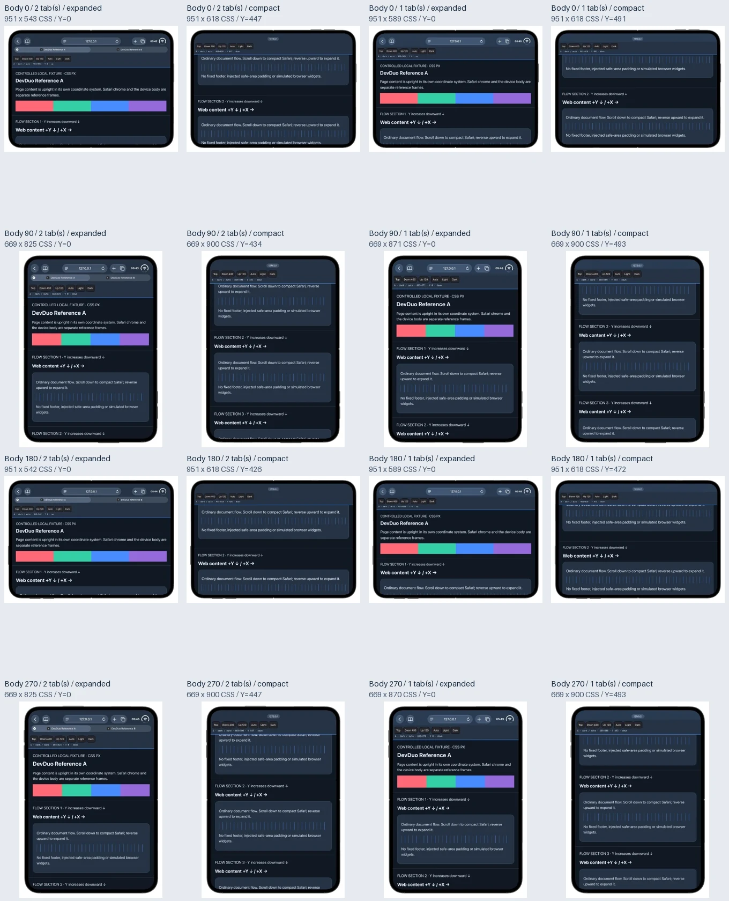
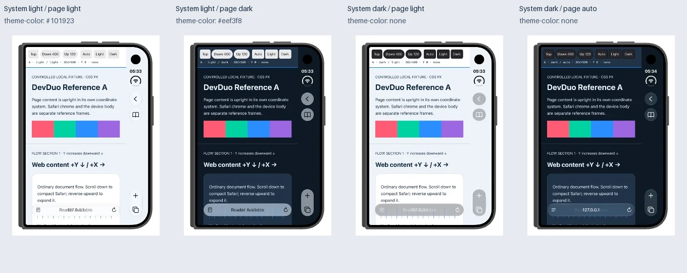

# Safari scene matrix

`config/safari-scenes.json` records actual Device Hub correspondence. **Body +90°** rotates the body in the canvas and selects its measured screen scene. Body angle, scene angle, actual DOM viewport, rendered DIP and unscaled component frames are recorded separately.

## Body-to-scene mapping

| Body angle | Closed scene | Sidebar | Open scene |
| --- | --- | --- | --- |
| 0° | 466 × 678 | right | 951 × 669 |
| 90° | 678 × 466 | right; camera below tabs | 669 × 951 |
| 180° | 678 × 466, retained preceding landscape | right | 951 × 669 |
| 270° | 678 × 466 | left; camera above navigation | 669 × 951 |

Closed 180° is the observed clockwise-sequence result, not proof of upside-down portrait support or every rotation history. Open mask rotation signs represent a symmetric outline, not extra hardware measurements. Partial-fold geometry remains unavailable.

## Body and content coordinate systems

`DevicePose` separates body-in-canvas rotation from content-in-body rotation. Each fold's measured body-zero pose defines its initial presentation: Closed uses the portrait artwork; Open uses that artwork rotated 90° to match its landscape body-zero scene. Subsequent body angles rotate the exterior and its screen opening mechanically from that pose.

Let `B` be the commanded body angle, `Z` the body-zero artwork rotation and `R` the independently observed `nativeSceneToCanvasClockwise` from the original Device Hub canvas. Artwork rotation is `Z + B`; content relative to the body is `R - B`; composing them gives the scene-to-canvas transform `R` (modulo 360). `sceneRotationDegrees` selects the screen mask and logical layout, not content direction. The new fields cite the 48-case manifest; original frame, viewport and source data are retained. All Open poses have R=0. Closed 180° has R=90 in this rotation-history cohort; other Closed poses have R=0.

Closed 90° therefore has an upright 678 × 466 scene in a landscape body. Closed 180° has a physically inverted portrait body, while the retained 678 × 466 scene is presented 90° clockwise in the canvas. They share measured layout, but no longer share body appearance. Windows rotates the complete live DirectComposition tree and inversely maps pointer coordinates; macOS uses an NSView frame transform, including native coordinate conversion. Fit and preview clipping are applied after these transforms, without resizing the DOM viewport or rendering snapshots.

## Viewport reference

All values are logical/CSS coordinates, not physical dimensions. The tab-strip switch applies only to Open Safari; immersive uses the complete scene and Closed has its own side widgets.

| Screen-coordinate scene | Tab variant | Initial viewport | Scrolled viewport |
| --- | --- | --- | --- |
| Closed 466 × 678 | side widgets | 382 × 580 | 382 × 598 |
| Closed 678 × 466 | side widgets | 594 × 368 | 594 × 386 |
| Open 951 × 669 | multiple | 951 × 543 | 951 × 618 |
| Open 669 × 951 | multiple | 669 × 825 | 669 × 900 |
| Open 951 × 669 | single | 951 × 589 | 951 × 618 |
| Open 669 × 951 | single | 669 × 871 | 669 × 900 |

Closed reserves side 84 and bottom 98/80. Open top reservation is 126 with multiple tabs, 80 with one tab and 51 when compact; the extra tab row consumes 46. Single-tab source Safari reports safe-area top 2 initially / 31 compact and bottom 34. These stay reference observations and are not injected into desktop CSS.

## Tab geometry and provenance

All titles use one 14-point medium scene font with vertically centered lines and truncation; Windows uses consistent pixel-unit font/alignment. Generic titles/favicons avoid copying private browsing content. The desktop Open multi-tab strip always presents two equal-width illustrative tabs, with the second selected, within the existing track. Both platforms consume the same presentation geometry; the 32-point row height, complete selected container and viewport reservations are retained. Original per-capture tab counts and frames remain unchanged in `config/safari-scenes.json`; the derived two-tab widths are presentation policy, not new native measurements. This shell is not a tab manager.

In the original captures, the selected `TabBarTab` hit rectangle excludes its 32-point close button. Preserve that hit frame, but paint the whole 32-point-high `TabBarItemTitleContainer`, validating its union with the close frame. At body 0°, selected width is 226.67 rather than the hit width 194.67; the other selected widths are 124.33, 150 and 100. One gray track, separators and the complete selected surface share the same geometry; paint/text clips at the next whole-tab origin while original overlapping AX frames remain source data. Colors, stroke softness and platform glass remain approximate.

The original single-tab sources live under `open-single-ORIENTATION/verified/`; failed idle-wait attempts remain separate. The canonical Open cohort used explicit display 3, because the default XCTest image could target another display. Source hashes and original native frames support the 24-state and four-angle whole-tab checks. Reproduction inputs and historical verifiers are documented once in the [archive guide](../../scripts/archive/README.md).

## Checked-in Device Hub reference gallery

The 2026-10-23 cohort includes **48 actual canvas crops, four matrix overview sheets and a color-trigger comparison**, encoded as WebP in `docs/shared/safari-reference/`. The [manifest](../shared/safari-reference/manifest.json) maps every combination to its image, actual DOM viewport/scrollY, native WebView and component frames, source hash, crop and derivative hash. The crops retain the observed body in canvas coordinates without rotating or rebuilding it. Overview sheets resize those crops for comparison; neither lossy images nor window capture pixels certify physical geometry or glass optics. Original window PNGs and failed attempts remain local.

| Fold | Captured combinations | Layout grouping |
| --- | --- | --- |
| Closed | Two shell palettes × four body angles × expanded/compact = 16 | Portrait/right widgets, landscape/right widgets, landscape/left widgets |
| Open | Two shell palettes × four body angles × one/two tabs × expanded/compact = 32 | Landscape and portrait; expanded single/multiple tabs differ, compact variants share a layout |

These give 24 semantic color/chrome/tab layout variants across the five content-layout groups; the complete 48-case index preserves every body angle and observed numeric difference. Closed 180° retains the preceding landscape scene **and its content is turned 90° clockwise in the canvas** in this cohort. Native scene coordinates must therefore be transformed separately from the exterior/body. Open has two content-layout classes across four body poses. A layout class is not a rotation angle or a claim that two original images are pixel-identical.

The main matrix covers **simulator Appearance Light/Dark** with matching automatic page colors (some Light cases explicitly select the identical light palette), without `theme-color`. Separate controls isolate page background, system appearance and opposing meta hints. A dark page under system Light changed the backdrop but did **not** reproduce system Dark's glass/glyph treatment. Under system Dark, a deliberately light page retained a light canvas with different material/icon treatment. Opposing `theme-color` hints did not override the page-driven appearance in these iOS 27.1 controls. This does not establish a universal priority rule for other Safari releases or arbitrary page backgrounds. The desktop observer now samples rendered content even with opposing meta hints, while shell appearance is an independent input. This aligns the controlled cohort without claiming a universal Safari policy. The controlled fixture contains no simulated Safari widgets or private browsing content.

| Condition | Observed behavior |
| --- | --- |
| Native scroll down | Address/navigation surface compacts; Open's extra tab row disappears |
| Reverse native scroll up | Navigation expands while scrollY can remain nonzero: Closed at Y=545, Open two tabs at Y=509 and one tab at Y=562; document position alone is not the chrome state |
| Programmatic `scrollTo` | Moved the fixture without compacting the observed Open Safari shell; it is a different input path |
| Tab count | One tab has no extra row; two and three have it in Open expanded navigation; Closed with two and Open compact hide it. “No tab strip” still means one real page tab |
| Fold/rotation transition | Can retain displaced chrome or stale viewport reservations; a further cross-fold attempt retained Open top chrome on a Closed exterior. Reject those attempts, re-establish the scene and verify both optics and actual viewport before capture |

The gesture direction and observed chrome are recorded separately from integer DOM scroll events. Do not implement the target as a fixed `scrollY` cutoff. Some new initial `innerHeight` readings are one CSS pixel below the earlier table; the manifest keeps the actual values and native floating-point frames rather than silently normalizing them. Default XCTest application bounds can describe another display, so use the active WebView/component frames and the visible Device Hub canvas independently. This cohort adds visual references; it does not rewrite the calibrated application config.

### Closed palettes

Rows are body 0°, 90°, 180°, 270°; columns are expanded, compact.

### Open palettes

Rows use the same four body angles. Columns are two tabs expanded/compact, then one tab expanded/compact.

### Color-trigger controls

Left to right: system Light/light page/dark meta; system Light/dark page/light meta; system Dark/light page/no meta; system Dark/auto dark page/no meta. The first two isolate the meta hint; the last two show why system theme and page-derived backdrop must remain separate inputs.

Follow [Calibration and validation](003-CALIBRATION-WORKFLOW.md) for capture/acceptance and the [Python guide](../../scripts/python/README.md) for native swipe and reproducible export commands. [Architecture](001-ARCHITECTURE.md) explains actual Closed under-chrome flow versus Open/Windows reserved-frame approximations; the [measurement contract](002-MEASUREMENT-CONTRACT.md) defines units and unknown hardware values. The derivatives retain Apple's UI/artwork provenance and do not acquire an MIT redistribution grant; see [third-party notices](../../THIRD_PARTY_NOTICES.md).

[English](005-SAFARI-SCENES.md) | [中文](../zh/005-SAFARI-SCENES.md)
