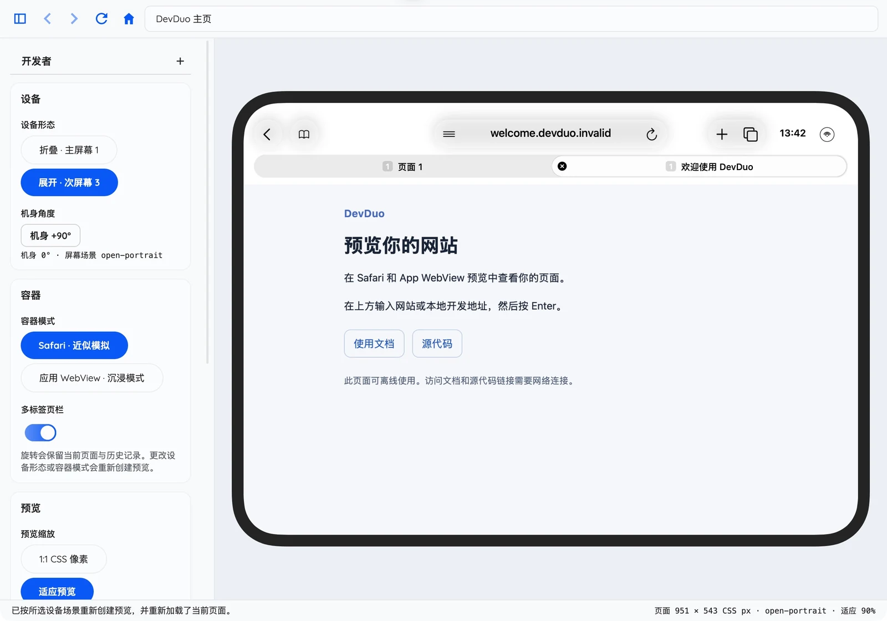
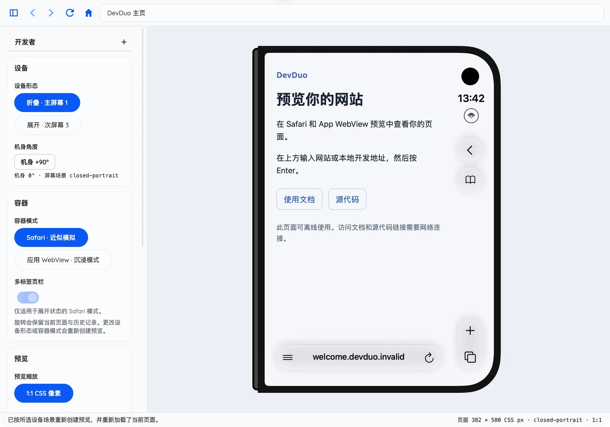

# DevDuo

**Pesudo iPhone Duo Viewport Simulator for Web Developers**

[English](../../README.md) · [简体中文](README.md) · [文档站](https://dev-duo.aitiotekt.com/zh/)

在桌面上，使用 iPhone Duo 模拟器的实测视口预览你的网站。切换折叠与展开布局，旋转机身，对比悬浮 Safari 外壳和沉浸式 App WebView 中的页面表现。

**[下载安装](#下载与安装)** · **[快速上手](#第一次预览)** · [使用指南](004-USAGE.md)

*macOS 应用实拍，展示内置离线欢迎页。[截图来源与处理说明](../shared/app-preview/provenance.json)。*

## 可以用它做什么？

- **对比两种容器。** 查看随页面着色的半透明 Safari 控件，或移除外壳，预览沉浸式应用布局。
- **检查响应式布局。** 对比两种折叠形态和四个机身角度；适应预览只缩放展示，保留逻辑 CSS 视口。
- **边看边调试。** 打开本地开发网址，使用 Web Inspector，并在 English 与简体中文界面之间切换。

DevDuo 是使用桌面 WebKit 的实验性布局辅助工具，不是 iOS 运行时。Safari 材质为近似效果，物理硬件尺寸和圆角仍未知。本项目独立开发，与 Apple 无关联。测量范围及证据见[场景参考](005-SAFARI-SCENES.md)。

## 下载与安装

打开 **[应用发行版](https://github.com/aitiotekt/DevDuo/releases)**，选择 `v…` 开头的版本，包括 beta 预发行版。单独的 `webkit-v…` 发行版是引擎依赖，并非 DevDuo 应用。若首个应用版本仍在准备，请稍后在该页面查看。

| 你的电脑 | 下载文件 | 安装方式 |
| --- | --- | --- |
| Apple 芯片 · macOS 27 或更新系统 | `DevDuo-v<version>-osx-arm64.zip` | 用访达解压，将 **DevDuo.app** 移入“应用程序”，然后打开。 |
| Windows · x64 | `DevDuo-v<version>-win-x64.zip` | 将整个 ZIP 解压到可写文件夹，运行其中的 **DevDuo.exe**。保留可执行文件旁随包提供的 `webkit/` 目录。 |

应用包包含 .NET、离线调试资源，以及 Windows 所需的匹配 WebKit 运行时。使用发行版无需安装 Xcode、mise、Node 或 Python。Intel Mac、Windows ARM 和 Linux 暂无应用发行包。

签名说明及下载被阻止时的处理见[发行包签名与安装帮助](013-RELEASE.md#发行包签名与安装帮助)。从源码构建请参阅[贡献指南](CONTRIBUTING.md)。

## 第一次预览

1. 启动 DevDuo。首次使用会显示离线欢迎页；随时点击**主页**即可返回。
2. 在顶部地址栏输入网站或本地开发网址，例如 `http://localhost:5173`，按 **Enter**。开发服务器需要在同一台电脑上单独运行。
3. 在设置侧栏选择**折叠**或**展开**，点击**机身 +90°**比较不同方向。
4. 选择 **Safari · 近似模拟**或**应用 WebView · 沉浸模式**。展开态 Safari 的**多标签页栏**预览两个示意标签，不会打开第二个页面。
5. 选择**适应预览**查看完整设备，或选择 **1:1 CSS 像素**查看未缩放的预览。按下拖动滑动页面，比较 Safari 外壳收窄和展开的状态；需要滚轮时，在**交互方式**中选择**鼠标**。

用 **⌘L / Ctrl+L** 聚焦地址栏，用 **⌘R / Ctrl+R** 重新加载。语言及浅色/深色主题位于**外观**分组。更多控件、快捷键和检查工具见[使用指南](004-USAGE.md)。

## 帮助与项目信息

| 想了解… | 从这里开始 |
| --- | --- |
| 操作、调试和设置 | [使用指南](004-USAGE.md) |
| 更新内容与后续改进 | [变更日志](CHANGELOG.md) · [UI 路线图](100-ROADMAP.md) |
| 报告问题或提出建议 | [GitHub Issues](https://github.com/aitiotekt/DevDuo/issues) — 请提供应用版本、操作系统及复现步骤。 |
| 开发与 AI 辅助贡献 | [贡献指南](CONTRIBUTING.md)负责环境和验证；[AGENTS.md](../../AGENTS.md)负责编码代理规范。 |
| 漏洞报告与本地数据 | [安全](SECURITY.md) · [隐私](PRIVACY.md) |
| 签名、证书和发布维护 | [发布与仓库管理](013-RELEASE.md) |
| 许可及随包组件 | 第一方代码使用 [MIT 许可证](../../LICENSE)；依赖及模拟器图形再分发的不确定事项见[第三方说明](THIRD_PARTY_NOTICES.md)。 |

[English](../../README.md) | [中文](README.md)
